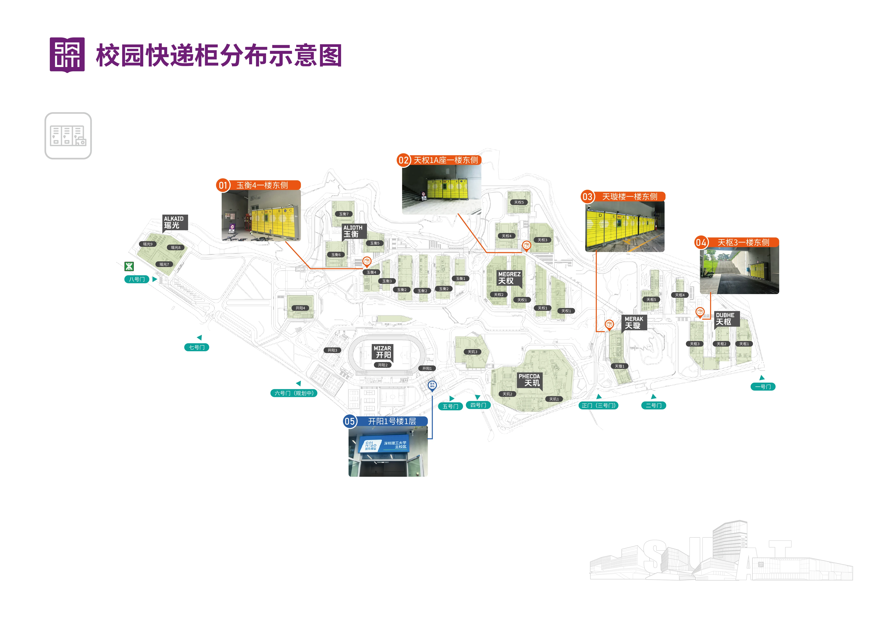

# 校园快递指南

校园目前采用“**小件进柜、中大件进驿站、超大件送到指定区域**”的取件方式。根据包裹大小和自己常活动的区域填写地址，可以少走不少路。

:::info 信息更新时间
本文根据总务处 **2026 年 8 月 31 日**发布的校园快递服务通知整理。快递柜点位和营业时间后续仍可能调整，请以学校和快递公司的最新通知为准。
:::

## 先按包裹大小选择

| 包裹类型 | 判断参考 | 推荐收货点 | 取件方式 |
| --- | --- | --- | --- |
| **小件快递** | 长、宽、高不超过 `45 × 35 × 30 cm` | 就近选择智能快递柜 | 24 小时自助取件 |
| **中大件快递** | 任一边超过上述对应尺寸 | 开阳 1 号楼菜鸟驿站 | `9:30–18:00` 人工服务 |
| **超大件货品** | 家具、家电、大型实验设备等 | 联系快递或物流人员 | 配送到校内约定区域 |

:::tip 不确定尺寸时
如果无法确认包裹能否入柜，填写菜鸟驿站地址更稳妥，可以避免柜门尺寸不合适导致投递异常。
:::

## 小件快递：就近选择快递柜

校园现有 4 处智能快递柜。下单时可以根据宿舍、办公或实验区域，就近填写下面任一地址。

| 快递柜 | 图片中的位置参考 |
| --- | --- |
| 玉衡区书院快递柜 | 玉衡 4 一楼东侧 |
| 天权区书院快递柜 | 天权 1A 座一楼东侧 |
| 天璇楼东侧快递柜（原点位） | 天璇楼一楼东侧 |
| 天枢区硕博公寓快递柜 | 天枢 3 一楼东侧 |

```text title="玉衡区书院快递柜"
广东省深圳市光明区新湖街道公常路1号深圳理工大学主校区玉衡区书院快递柜
```

```text title="天权区书院快递柜"
广东省深圳市光明区新湖街道公常路1号深圳理工大学主校区天权区书院快递柜
```

```text title="天璇楼东侧快递柜（原点位）"
广东省深圳市光明区新湖街道公常路1号深圳理工大学主校区天璇楼25栋智能快递柜
```

```text title="天枢区硕博公寓快递柜"
广东省深圳市光明区新湖街道公常路1号深圳理工大学主校区天枢区硕博公寓快递柜
```



如果所选快递柜已满，小件包裹会统一暂存到开阳 1 号楼菜鸟驿站。最终取件地点请以短信或购物平台的取件通知为准。

## 中大件快递：填写菜鸟驿站

中大件包裹统一放在新菜鸟驿站，地址如下：

```text title="新菜鸟驿站"
广东省深圳市光明区新湖街道公常路1号深圳理工大学主校区开阳1号楼1F-19号
```

在购物平台中可以这样填写：

```text
收件人：填写本人姓名
手机号码：填写本人手机号码
所在地区：广东省深圳市光明区新湖街道
详细地址：公常路1号深圳理工大学主校区开阳1号楼1F-19号
```

新驿站位于开阳 1 号楼一层，在 5 号门对面、网球场旁，人工服务时间为 **9:30–18:00**。具体位置也可以查看 [深理工地图](../深理工手册/深理工地图.md)。

## 超大件货品

家具、家电和大型实验设备等超大件货品无需前往驿站自提。请提前联系快递或物流工作人员，协商送到校内指定区域，并保持手机畅通。

## 取件与问题处理

- 收到通知后，请先确认包裹被送往哪一处快递柜或菜鸟驿站。
- 建议及时取件，避免快递柜长期占用，方便柜位周转。
- 快递柜已满时，小件包裹可能转存至菜鸟驿站。
- 前往菜鸟驿站取件时，准备好取件码并按现场指引操作。
- 如果不小心拿错快递，请及时联系现场工作人员处理。

## 咨询方式

- 驿站负责人郭金宝：**[15989859867](tel:15989859867)**
- 总务处王老师：**[17722595895](tel:17722595895)**
