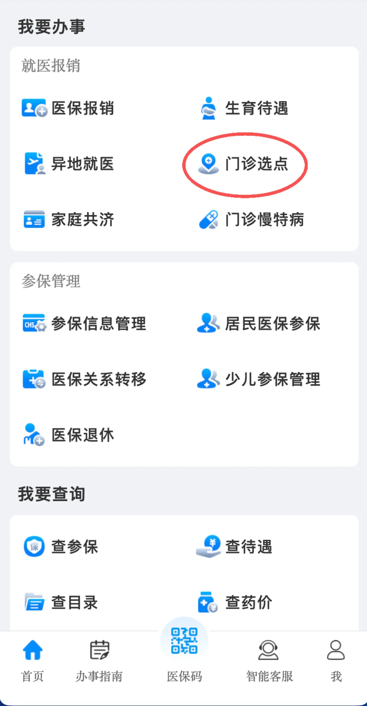

# 校医院及医保相关

本文整理校医室、深圳大学生医保选点，以及学校附近医疗机构的实用信息。

:::warning 就医信息可能调整
医保政策、报销比例和医疗机构安排可能发生变化，办理前请以“深圳医保”官方平台、医院及学校最新通知为准。突发严重不适请直接拨打 **120**。
:::

## 校医室

校医室目前类似于基础诊所，可以处理常见的轻症和简单外伤，暂不支持医保门诊报销。

| 项目 | 信息 |
| --- | --- |
| **位置** | 天枢 5 号楼（23 栋，即硕博公寓）一楼东北侧 |
| **营业时间** | 周一至周五 9:00–12:00、14:00–18:00 |
| **联系电话** | [13923893313](tel:13923893313) |

### 非营业时间怎么办

- 身体不适时，可以先拨打校医室电话咨询。
- 出现突发剧痛、高烧不退、呼吸困难、严重外伤等紧急情况，请立即拨打 **120**，不要等待校医室营业。

---

## 深圳大学生医保

深圳全日制普通高校学生统一参加深圳市居民基本医保（学生类），学校通常负责集中办理参保和缴费手续。

### 就医前必须完成：门诊选点

:::danger 门诊报销一定要先选点
深圳大学生医保普通门诊需要绑定一家社康。参保人通常只能在**所绑定的社康、该社康所属的上级医院，以及该上级医院下辖的社康**享受普通门诊医保待遇。前往其他医院就医前，需要先到所绑定的社康办理转诊，否则一般无法按规定报销。
:::

- **首次绑定**：绑定后立即生效。
- **变更绑定**：如果当月已经使用过医保，变更后通常于次月生效；如果当月尚未使用医保，变更通常即时生效。
- **办理渠道**：可通过“粤省事”或“深圳医保”微信小程序办理。

在“深圳医保”的“掌上办事”中选择“门诊选点”，即可绑定或更换社康：

### 中山七院就医提醒

距离学校较近的**中山大学附属第七医院（中山七院）没有下属社康**。因此，如果绑定的是其他医疗集团的社康，前往中山七院普通门诊就医前，通常需要先在所绑定的社康办理转诊，才能按规定享受医保待遇。

学校附近的社康多属于光明区人民医院医疗集团，例如：

- 新羌社康
- 圳美社康

新湖街道办社康目前不对外开放。对于普通感冒、咳嗽、发烧等常见疾病，在光明区社康办理前往中山七院的转诊有时会比较困难，并非完全不能办理，具体由接诊医生根据病情判断。

### 门诊报销比例

医保目录内费用的报销比例会因医疗机构级别和最新政策而变化。原有参考信息如下：

- 一级医疗机构或社康：统筹报销约 **75%**，个人自付约 25%。
- 二级医院：报销约 **65%**。
- 三级医院：报销约 **55%**。

就医时可使用电子医保凭证结算，实际报销结果以医保结算页面为准。

### 参保范围

1. 深圳全日制普通高校在校生通常可以参加大学生医保。
2. 非全日制、继续教育、在职研究生和短期交换生等，一般不纳入学校统一参保范围，具体以当年通知为准。

### 缴费标准

以下为 **2026–2027 医保年度（2026 年 9 月至 2027 年 8 月）**的原有参考信息：

- 缴费基数：6760 元/月。
- 总费率 1.8%：个人承担 0.6%，财政补贴 1.2%。
- 个人缴费：40.56 元/月，全年合计 **486.72 元/人**。
- 学校通常在开学季统一办理缴费；低保、特困、孤儿等困难学生可按政策申请个人缴费财政减免。

---

## 附近医疗机构

### 三级医院

学校周边主要有以下三级医院：

- 中山大学附属第七医院
- 深圳市光明区人民医院（东院区、西院区、总院区）
- 深圳市中医院光明院区

### 中山大学附属第七医院

| 项目 | 信息 |
| --- | --- |
| **门诊时间** | 周一至周日 8:00–12:00、14:30–17:30，法定节假日另行通知 |
| **门诊咨询电话** | [0755-81206900](tel:075581206900)、[0755-81206999](tel:075581206999)，每日 8:00–22:00，节假日除外 |
| **急诊急救电话** | [0755-81206921](tel:075581206921)，24 小时 |

### 社康就医建议

社康报销比例相对较高，普通感冒、咳嗽等常见疾病通常可以直接处理，没有必要一开始就前往大医院。

综合距离和公共交通，比较推荐**光明区人民医院圳美社康**，可乘地铁到达。一般无需提前预约挂号，到现场后按指引排队就诊即可。实际接诊安排以社康当天通知为准。

如果确实需要前往中山七院普通门诊，记得先确认自己的绑定社康和转诊要求，避免因未办理转诊而无法报销。

---

## 住院就医与报销

1. **结算方式**：深圳市内定点医院住院通常无需门诊转诊。入院时出示身份证或电子医保凭证，出院时直接结算并支付个人自付部分。
2. **参考起付线**：一级医院 300 元、二级医院 400 元、三级医院 500 元；起付线以下费用通常由个人承担。
3. **参考报销比例**：起付线以上、医保目录内的费用，统筹报销比例约为 70%–90%，一般医疗机构等级越低，报销比例越高。
4. **参考年度限额**：基本医保统筹年度最高支付限额原有信息为 48 万元；符合条件的高额自付费用还可能通过大病保险再次报销。

以上住院数据可能随医保年度调整，就医前请通过“深圳医保”官方平台确认。
