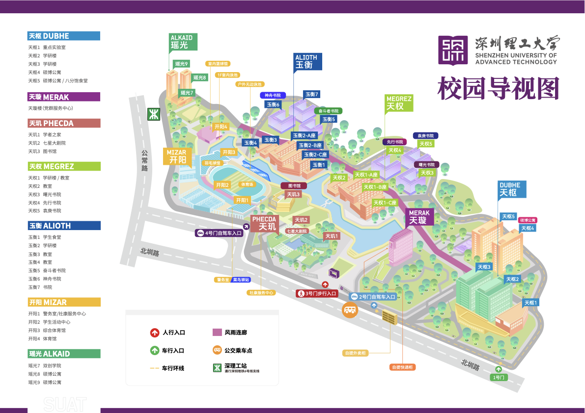

# 深理工地图

## 🌐 VR 全景导览

校园航拍与实景图（截至 25 年 8 月）。

[**点击查看深理工 VR 全景图 →**](https://8b2fecdr1.wasee.com/wt/8b2fecdr1)

做得蛮好的，推荐新生入学前先云游一圈～

---

## 🗺️ 平面地图

下面是 2026 年版校园示意图。点击图片可以打开高清 PDF，放大查看建筑与设施名称。

<div style={{maxWidth: "100%"}}>

[](./images/校园示意图-2026.pdf)

</div>

[**打开高清校园示意图 PDF →**](./images/校园示意图-2026.pdf)

---

## 📍 常用传送锚点

刚到学校找不到地方？下面整理了校内常用地点和地址，建议新生提前收藏。

### 📦 快递站

- **菜鸟驿站**：开阳 1 号楼 `1F_19` 号，位于 5 号门对面、网球场旁。
- **智能快递柜**：八分饱区域连廊下方、党群服务中心外部。

**快递地址：**

```text
广东省深圳市光明区公常路1号深圳理工大学主校区
```

:::tip 填写收货信息时请注明取件点
建议在详细地址或备注中标清楚送往“菜鸟驿站”还是“智能快递柜”，避免快递被送到错误位置。
:::

更多收寄件信息请查看 [校园快递指南](../办事指南/校园快递指南.md)。

### 🛵 外卖柜

外卖通常送到 2 号门旁边的外卖柜或外卖柜旁的桌子：

- **美团外卖**：通常放入美团外卖柜。
- **其他平台外卖**：通常放在外卖柜旁的桌子上。

根据下单平台选择对应地址：

```text title="美团外卖"
深圳理工大学（光明校区）2号门外卖柜
```

```text title="其他平台外卖"
深圳理工大学（光明校区）2号门外卖柜旁桌子
```

### 🧭 校内常用地点

| 地点             | 位置与使用提示                                                                                        |
| ---------------- | ----------------------------------------------------------------------------------------------------- |
| **校内小超市**   | 八分饱食堂（天枢 5 号楼）一层                                                                         |
| **医务室**       | 天枢 5 号楼（23 栋，即硕博公寓）一层东北侧房间                                                        |
| **羽毛球场**     | 开阳 3 号楼一楼，操场旁边                                                                             |
| **图书馆**       | 适合安静学习，节假日通常正常开放，一般在 22:15 熄灯关门                                               |
| **露天无边泳池** | 一般在 15:00–21:00 开放，凭校园卡登记个人信息即可进入；设有地下男女更衣室和淋浴房，可以带衣服前往更换 |

:::info 开放时间仅供参考
图书馆、泳池和体育场馆的开放安排可能因节假日、天气或学校通知而调整，出发前建议关注最新通知。
:::

详细信息可继续查看：

- [校医院及医保相关](../校园生活/校医院及医保相关.md)
- [体育场馆预约](../办事指南/体育场馆预约.md)
